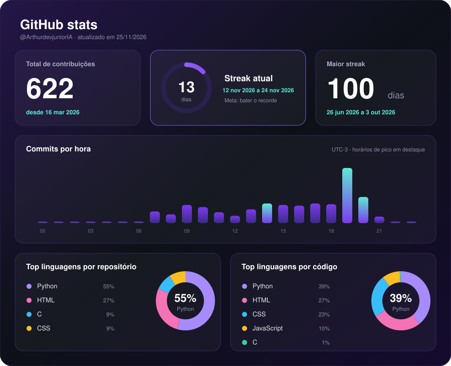

<!-- ===================== HEADER ===================== -->
<div align="center">


<a href="https://github.com/ArthurdevjuniorIA">
  
</a>

<br/>


<br/><br/>

<a href="mailto:marisanascimento772@gmail.com"></a>
<a href="https://github.com/ArthurdevjuniorIA"></a>


</div>

<br/>

---

## 👨‍💻 Sobre mim

```python
class ArthurKaua:
    def __init__(self):
        self.local = "Natal, RN 🇧🇷"
        self.foco = ["Backend Python", "APIs REST", "Algoritmos", "Automação"]
        self.mindset = "código limpo, validado e à prova de erro humano"
        self.status = "aberto a estágio / jovem aprendiz / júnior"

    def lema(self):
        return "A persistência é o caminho do sucesso."
```

Sou estudante de tecnologia em Natal, RN, com foco em **backend com Python**. Gosto de transformar regras de negócio em código limpo e validado: travas de segurança, cálculos automatizados e sistemas que evitam erro humano.

- 🤝 Contribuo com um projeto **open source real**, o [Dados Livres](https://dadoslivres.org), e trabalho em equipe usando Git, Pull Requests e code review.
- 🧠 Estudo algoritmos e estruturas de dados (OBI) e fundamentos de computação em C/C++.
- 🌐 Tenho base em front-end (HTML, CSS, JavaScript) para integrar com os serviços que construo.
- 📈 Atividade constante no GitHub desde junho, com contribuições em projetos de organizações como [Projeto-Dados-Livres](https://github.com/Projeto-Dados-Livres) e [First Contributions](https://github.com/firstcontributions).

---

## 🧰 Tech stack

<div align="center">


<br/>


</div>

<br/>

| Área | Tecnologias |
|:--|:--|
| 🐍 **Linguagens** | Python · JavaScript · C · C++ · SQL |
| ⚙️ **Backend** | Flask · FastAPI · REST APIs · PostgreSQL |
| 🎨 **Frontend** | HTML5 · CSS3 · JavaScript · Bootstrap |
| 🛠️ **Ferramentas** | Git · GitHub · Docker Compose · Linux · VS Code · GDB · Valgrind |

---

## 🔨 Projetos em destaque

<table>
<tr>
<td width="50%" valign="top">

### 🌐 [Dados Livres](https://github.com/Projeto-Dados-Livres/Dados-Livres)
<sub>[dadoslivres.org](https://dadoslivres.org) · Open source · GPLv3</sub>

Plataforma livre para catalogar fontes de dados abertos e aplicações cívicas por colaboração coletiva, alinhada aos **ODS 10 e 16 da ONU**. Nasceu como projeto de pesquisa no IFRN.


</td>
<td width="50%" valign="top">

### 🚚 [GlobalMove Logística](https://github.com/ArthurdevjuniorIA/Sistema-de-gestao-de-frota-e-logistica)
<sub>Gestão de frotas · Arquitetura modular em camadas</sub>

Sistema de gestão de frotas e distribuição de cargas.

- 🔒 **Trava operacional:** bloqueia sobrecarga e veículos em rota ou manutenção
- ⛽ **Calculadora de viagem:** combustível por distância, consumo e preço do dia
- 🪪 **Cadastro por placa:** furgão, caminhão leve e carreta


</td>
</tr>
<tr>
<td colspan="2" valign="top">

### 🏊 [Learning Python with Real Projects](https://github.com/ArthurdevjuniorIA/Learning-Python-with-a-real-projects-in-classroom)

Projetos em equipe com o fluxo de trabalho de times de software: branches, commits semânticos, Pull Requests e revisão de código. Destaque: o **Nado Livre**, sistema de controle de toalhas com cadastro de nadadores, estoque, histórico de movimentações e validação de entradas.


</td>
</tr>
</table>

<!-- Dica: adicione um print do GlobalMove bloqueando sobrecarga:
<p align="center"></p> -->

---

## 📚 Em estudo

<details>
<summary><b>🌐 HTML, CSS & JavaScript</b> &nbsp;·&nbsp; clique para abrir</summary>
<br/>

Front-end na prática: HTML semântico, CSS, lógica em JavaScript puro e manipulação de DOM.

👉 [Ver repositório](https://github.com/ArthurdevjuniorIA/HTML-CSS-JAVASCRIPT-learning-with-projects)

</details>

<details>
<summary><b>⚙️ Jornada em C e C++</b> &nbsp;·&nbsp; clique para abrir</summary>
<br/>

Ponteiros, alocação dinâmica, stack vs. heap, estruturas de dados do zero e POO, com **GDB** e **Valgrind**.

<!-- 👉 [Ver repositório](COLOQUE_O_LINK_AQUI) -->

</details>

<details>
<summary><b>📖 Referências de estudo</b> &nbsp;·&nbsp; clique para abrir</summary>
<br/>

CS50x (Harvard) · Nand2Tetris · *C Programming: A Modern Approach* (K. N. King) · *Dive into Systems* · Beej's Guide to C · cppreference.com

</details>

---

## 🧠 No que estou focado

| | Foco | O que significa na prática |
|:-:|:--|:--|
| ⚙️ | **Backend e APIs** | Regras de negócio em camadas, validações rigorosas, APIs REST com Flask/FastAPI |
| ✅ | **Qualidade de código** | Testes automatizados, código modular e documentação clara |
| 🤝 | **Colaboração profissional** | Git flow, Pull Requests, code review e commits semânticos |
| 🧮 | **Algoritmos e estruturas de dados** | Problemas de competição (OBI), listas, pilhas, filas e árvores |
| 🖥️ | **Fundamentos de computação** | Gestão de memória e como o código interage com o sistema operacional |

<!-- Se tiver um resultado na OBI, adicione na linha de algoritmos: fase, medalha ou pontuação. -->

---

## 🎯 Metas

- [x] Fundamentos de programação em Python
- [x] Trabalhar em equipe com Git e Pull Requests
- [x] Contribuir com um projeto open source
- [ ] Testes automatizados (pytest) nos meus projetos
- [ ] API REST completa com persistência (GlobalMove, Fase 2)
- [ ] CI com GitHub Actions
- [ ] Dashboard web do GlobalMove (Fase 3)
- [ ] Estruturas de dados em C e introdução a C++
- [ ] Concluir o CS50x

---

## 📊 Atividade no GitHub

<div align="center">



<br/><br/>


</div>

---

## 🤝 Equipe

Colaboro em projetos de sala com [@Marcuspdev](https://github.com/Marcuspdev) e [@andrewqdev](https://github.com/andrewqdev).

---

## 📫 Vamos conversar

Estou aberto a conversar sobre **estágio, jovem aprendiz ou oportunidades júnior** em desenvolvimento backend.

<div align="center">

<a href="mailto:marisanascimento772@gmail.com"></a>
<a href="https://github.com/ArthurdevjuniorIA"></a>

<br/><br/>

<i>"A persistência é o caminho do sucesso."</i>


</div>
